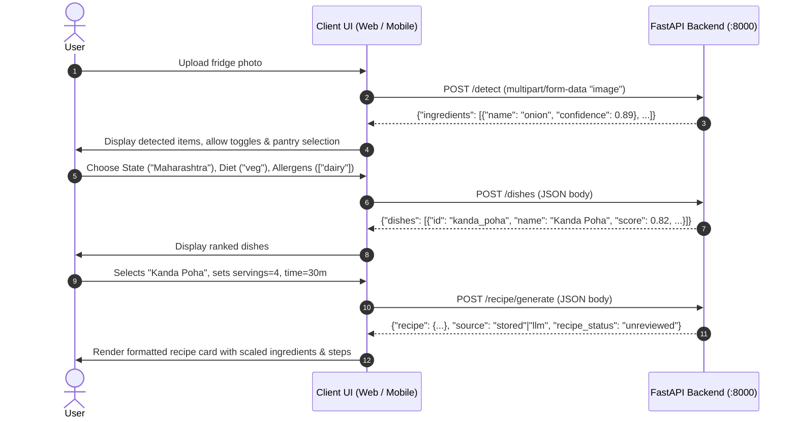

# Pantry to Plate — Regional Recipe Assistant (2-Model Edge Backend)

A production-grade, 2-model regional Indian recipe engine built for laptop GPUs (RTX 5050/4060/3060) and edge devices (NVIDIA Jetson). It converts produce photos into verified, authentic regional recipes through a 3-layer pipeline.

---

## Architecture Overview

```
[ User Photo ]
      │
      ▼
┌─────────────────────────────────────────────────────────────┐
│ Layer 1: In-Memory Produce Detector (Ultralytics YOLOv8m)   │
│ - Endpoint: POST /detect                                    │
│ - Latency: ~38 ms (GPU) / <103 ms (Jetson)                  │
│ - Strips EXIF metadata, 0 disk writes, in-memory processing │
└─────────────────────────────────────────────────────────────┘
      │ Detected Ingredients: ["onion", "potato", ...]
      ▼
┌─────────────────────────────────────────────────────────────┐
│ Layer 2: Deterministic Dish Scorer (Regional Graph & Diet)   │
│ - Endpoint: POST /dishes                                    │
│ - Catalog: 395 authentic dishes across 7 Indian states      │
│ - Proximity weighting (state_neighbours.csv), hard veg &   │
│   allergen filters, 50% match eligibility threshold         │
└─────────────────────────────────────────────────────────────┘
      │ Candidate Dishes + Selected dish_id
      ▼
┌─────────────────────────────────────────────────────────────┐
│ Layer 3: Recipe Generator & Catalog Fallback Engine         │
│ - Endpoint: POST /recipe/generate                           │
│ - Scaling: Code calculates scaled quantities for servings   │
│ - Step Generation: LLM writes plain text steps (Qwen 1.5B)  │
│ - 5 Step Validators: word counts, unallowed ingredients,     │
│   allergens, commercial spice blends                        │
│ - Zero-Failure Fallback: Returns stored recipe if LLM fails │
└─────────────────────────────────────────────────────────────┘
```

---

## Directory Structure

```
DL_Capstone_Poject/
├── api/
│   └── main.py                     # FastAPI application (6 production endpoints)
├── src/
│   ├── scorer.py                   # Layer 2: DishScorer & canonical normalization
│   ├── writer.py                   # Layer 3: RecipeWriter (Qwen base & stored fallback)
│   ├── validators.py               # Layer 3: Step & allergen validation rules
│   ├── protein.py                  # IFCT 2017 protein lookup engine
│   └── nutrition.py                # ICMR nutritional database
├── data/
│   ├── cnn/best.pt                 # YOLOv8m produce weights (63 classes)
│   ├── raw/
│   │   ├── maharashtra_drafts.csv  # 395 catalog dishes with ingredients & steps
│   │   └── state_neighbours.csv    # Regional proximity graph
│   └── staples.json                # Free universal pantry staples (salt, oil, etc.)
├── docs/
│   ├── writer_eval_v2.json         # Layer 3 (v2) benchmark results
│   ├── REFERENCES.md               # Dataset and model citations
│   └── JETSON_NOTES.md             # Edge deployment guidelines
├── tests/
│   ├── test_scorer.py              # Layer 2 unit & integration tests
│   ├── test_writer.py              # Layer 3 unit & validator tests
│   ├── eval_writer_v2.py           # 20-case evaluation benchmark
│   └── sample_requests/            # Ready-to-use curl JSON payloads
├── config.json                     # Scorer weights, pantry items, llm_mode
├── README_API.md                   # Full endpoint reference & JSON schemas
└── README.md                       # Main documentation & agent integration guide
```

---

## How to Run & Verify

### 1. Prerequisites & Virtual Environment
Ensure Python 3.10+ and CUDA (if using GPU) are installed.
```powershell
cd DL_Capstone_Poject
.\venv\Scripts\Activate.ps1
```

### 2. Run Test Suites
```powershell
# Run Layer 2 Scorer tests
.\venv\Scripts\python.exe -m unittest -v tests/test_scorer.py

# Run Layer 3 Writer & Validator tests
.\venv\Scripts\python.exe -m unittest -v tests/test_writer.py
```

### 3. Launch Backend API Server
```powershell
.\venv\Scripts\uvicorn.exe api.main:app --host 127.0.0.1 --port 8000
```
API Documentation & Interactive Swagger UI: `http://127.0.0.1:8000/docs`

---

## AI Agent Integration Guide (Adding This Layer into Your App)

If you are an AI coding agent or engineer building a web frontend, mobile UI, or client service, follow this exact workflow to integrate the 3 layers.

### Client Workflow Sequence



---

### Step 1: Detect Produce (`POST /detect`)
Send the user's produce picture as `multipart/form-data`.
- **Field Name**: `image`
- **Supported Formats**: JPEG, PNG (Max size: 10 MB).
- **Processing**: EXIF stripped in RAM, 0 disk writes.

```javascript
// JavaScript / TypeScript example
const formData = new FormData();
formData.append("image", fileInput.files[0]);

const detectRes = await fetch("http://127.0.0.1:8000/detect", {
  method: "POST",
  body: formData
});
const detectData = await detectRes.json();
// detectData.ingredients -> [{ name: "onion", confidence: 0.91 }, { name: "potato", confidence: 0.85 }]
```

---

### Step 2: Score & Filter Dishes (`POST /dishes`)
Send detected ingredients along with user's pantry items, target state, and dietary restrictions.

```javascript
const dishesRes = await fetch("http://127.0.0.1:8000/dishes", {
  method: "POST",
  headers: { "Content-Type": "application/json" },
  body: JSON.stringify({
    ingredients: detectData.ingredients.map(i => i.name),
    pantry: ["oil", "salt", "mustard seeds", "turmeric"],
    state: "Maharashtra",
    vegetarian_only: true,
    allergens: []
  })
});
const dishesData = await dishesRes.json();
// dishesData.dishes -> Array of top matching dishes with score, matched items, and missing items
```

---

### Step 3: Generate or Retrieve Scaled Recipe (`POST /recipe/generate`)
When the user clicks on a dish from the ranked list, generate the tailored recipe.

```javascript
const recipeRes = await fetch("http://127.0.0.1:8000/recipe/generate", {
  method: "POST",
  headers: { "Content-Type": "application/json" },
  body: JSON.stringify({
    dish_id: "kanda_poha",
    ingredients: ["poha", "onion"],
    pantry: ["oil", "salt"],
    servings: 4.0,           // Quantities scale automatically
    time_limit: 30,          // Time limit in minutes
    allergens: ["dairy"],    // Strictly excluded allergens
    vegetarian_only: true
  })
});
const recipeData = await recipeRes.json();
/*
recipeData = {
  recipe: {
    dish_name: "Kanda Poha",
    local_name: "Kande Pohe",
    ingredients: [{ item: "poha", quantity: "3 cup" }, ...],
    steps: ["Place flattened rice in a colander...", ...],
    time_minutes: 20,
    missing_ingredients: []
  },
  source: "stored",          // "stored" or "llm"
  recipe_status: "unreviewed",// "reviewed" only if demo_ready == "yes"
  validation: { passed: true, failures: [] },
  warnings: ["..."]
}
*/
```

---

### End-to-End Python Client Blueprint
An AI agent building a Python backend or pipeline can use this single script:

```python
import httpx

BASE_URL = "http://127.0.0.1:8000"

def run_recipe_pipeline(image_path: str, state="Maharashtra", servings=4.0):
    with httpx.Client(base_url=BASE_URL, timeout=30.0) as client:
        # 1. Detect ingredients
        with open(image_path, "rb") as f:
            detect_res = client.post("/detect", files={"image": ("photo.jpg", f, "image/jpeg")})
            detect_res.raise_for_status()
            detected_items = [i["name"] for i in detect_res.json()["ingredients"]]

        # 2. Get ranked candidate dishes
        scorer_payload = {
            "ingredients": detected_items,
            "pantry": ["oil", "salt", "turmeric", "mustard seeds"],
            "state": state,
            "vegetarian_only": True,
            "allergens": []
        }
        dishes_res = client.post("/dishes", json=scorer_payload)
        dishes = dishes_res.json().get("dishes", [])
        if not dishes:
            print("No matching dishes found for the given ingredients.")
            return None

        top_dish = dishes[0]
        print(f"Top Matched Dish: {top_dish['name']} (Score: {top_dish['score']})")

        # 3. Retrieve or generate recipe
        gen_payload = {
            "dish_id": top_dish["id"],
            "ingredients": detected_items,
            "pantry": ["oil", "salt"],
            "servings": servings,
            "time_limit": 30,
            "allergens": [],
            "vegetarian_only": True
        }
        recipe_res = client.post("/recipe/generate", json=gen_payload)
        recipe_data = recipe_res.json()
        return recipe_data["recipe"]
```

---

## Critical Invariants & Rules for AI Agents

1. **Guaranteed Non-500 Fail-Safe**:
   `POST /recipe/generate` will **NEVER** return HTTP 500 because of an LLM, GPU, CUDA Out-Of-Memory, or parsing error. When anything fails or when `LLM_MODE=off`, it transparently returns the catalog recipe with `source: "stored"`.
2. **Review Status Transparency**:
   `recipe_status` is `"reviewed"` **only** if the dish has `demo_ready == "yes"` in the catalog. All other dishes are labeled `"unreviewed"`. Do not alter this field in the UI.
3. **Shopping List Safety**:
   `missing_ingredients` uses simple name matching (e.g. `"peanuts"` vs `"raw peanuts"`). Inform users this is an estimate and not yet a certified shopping list.
4. **Validation Scope**:
   `validation.passed` reflects the validation of the LLM generation attempt. When `source == "stored"`, the recipe provided is the catalog recipe regardless of the LLM attempt's outcome.
5. **Configuration Modes**:
   - `LLM_MODE=off` (Default): Returns verified catalog recipes in <1 ms with 0 GPU consumption. Recommended for production stability.
   - `LLM_MODE=base`: Uses base `Qwen2.5-1.5B-Instruct` in fp16/bf16 to generate cooking steps dynamically.

---

## Reference & Documentation
- Detailed API Schema & Error Codes: [README_API.md](file:///c:/Users/ACER/Desktop/Dev/DL_Project/DL_Capstone_Poject/README_API.md)
- Dataset & Model References: [docs/REFERENCES.md](file:///c:/Users/ACER/Desktop/Dev/DL_Project/DL_Capstone_Poject/docs/REFERENCES.md)
- Jetson Deployment Notes: [docs/JETSON_NOTES.md](file:///c:/Users/ACER/Desktop/Dev/DL_Project/DL_Capstone_Poject/docs/JETSON_NOTES.md)
